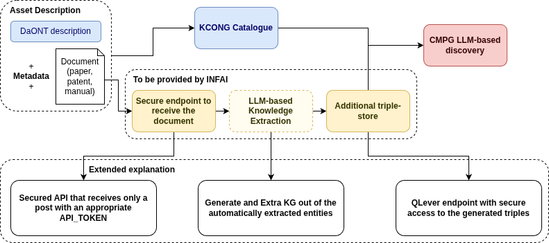

# Federated Extractor

## 1. Overview

Federated Extractor turns technical PDF content into structured RDF knowledge
and makes that knowledge available through a protected SPARQL API. FastAPI
handles uploads and application authorization, while QLever stores and queries
the RDF graph.



## 2. What it does

- Extracts embedded text from PDFs, with optional OCR fallback.
- Produces RDF using ontology-guided, event, and facts-and-attributes methods.
- Stores uploaded PDFs and token metadata locally.
- Proxies approved SPARQL operations from FastAPI to QLever.
- Protects API operations with `reader`, `writer`, and `admin` tokens.

| Operation | Reader | Writer | Admin |
| --- | --- | --- | --- |
| Query RDF | Yes | Yes | Yes |
| Update RDF | No | Yes | Yes |
| Clear QLever cache | No | No | Yes |

## 3. Setup

### Requirements

The project was built for the following environment:

| Tool | Version / requirement |
| --- | --- |
| Python | 3.12 |
| uv | Current stable release; used to create the virtual environment |
| Docker Engine | Required by QLever; tested with 29.1.3 |
| QLever CLI | 0.5.50 |
| FastAPI | 0.141.1 |
| Uvicorn | 0.52.1 |

The API and QLever Python package versions are pinned in `requirements.txt`.
The extraction scripts additionally require PyMuPDF and spaCy with the small
English model.

### Install and configure

From the repository root:

```bash
uv venv --python 3.12
source .venv/bin/activate
uv pip install -r requirements.txt
uv pip install pymupdf spacy
python -m spacy download en_core_web_sm

cp .env.example .env
```

Edit `.env` and replace the placeholders. `EXTRACTOR_SYSTEM_KEY` is used to
hash application API tokens; keep it unchanged while tokens exist, or those
tokens will no longer authenticate. `QLEVER_ACCESS_TOKEN` is the separate
credential QLever uses to protect privileged store operations. For example,
generate a value locally with `openssl rand -hex 32` and put it in `.env`.
Keep `.env` private and do not commit it.

Load the settings into the current shell before running the token CLI, QLever,
or FastAPI:

```bash
set -a
source .env
set +a
```

The defaults use `system.db` for token and upload metadata, `uploads/` for
uploaded PDFs, and `http://localhost:7001` for QLever. The optional
`EXTRACTOR_DB_PATH`, `EXTRACTOR_UPLOAD_DIR`, and `QLEVER_URL` environment
variables can override those paths and the QLever URL.

### Start the triple-store

QLever runs in Docker, managed by the QLever CLI. The checked-in
`qlever/Qleverfile` indexes a small fixture graph by default:

```bash
cd qlever
qlever index
qlever start --access-token "$QLEVER_ACCESS_TOKEN"
cd ..

python scripts/check_qlever.py
```

The local QLever SPARQL endpoint is `http://localhost:7001`. The smoke check
confirms the fixture is queryable. See [QLever triple-store](#6-qlever-triple-store)
for loading extractor output and querying or updating the graph.

### Create tokens and start the API

Create one or more application tokens from the repository root. The default
role is `reader`; use `--role` to grant `writer` or `admin`:

```bash
python -m cli.manage_tokens create
python -m cli.manage_tokens create --role writer
python -m cli.manage_tokens create --role admin
```

The CLI prints each plaintext token once. Save it securely; the database
stores only its HMAC hash. Start FastAPI in the same configured shell:

```bash
uvicorn app.main:app --host 0.0.0.0 --port 8000
```

Open `http://localhost:8000/docs` for the interactive API reference.

## 4. Upload API and application tokens

The upload endpoint accepts a PDF and registers its filename in the local
database. It does not run extraction or add triples to QLever. Send any valid
application token in the `X-API-Token` header:

```bash
curl -X POST http://localhost:8000/upload \
  -H "X-API-Token: <reader-token>" \
  -F "file=@/path/to/document.pdf;type=application/pdf"
```

On success, the PDF is saved under `uploads/` (or the configured
`EXTRACTOR_UPLOAD_DIR`) and a database record is created. The response reports
success; run the extractor separately to produce RDF.

Token management commands are run from the repository root with `.env`
loaded:

```bash
# Create a least-privilege reader token (also the default role).
python -m cli.manage_tokens create --role reader

# Check a known token, remove a token, or list stored hashes and roles.
python -m cli.manage_tokens verify '<token>'
python -m cli.manage_tokens delete '<token>'
python -m cli.manage_tokens list
```

`list` shows hashes, not the original tokens. The API requires `X-API-Token`
for uploads and SPARQL operations. The authorization matrix is:

| Operation | Reader | Writer | Admin |
| --- | --- | --- | --- |
| Upload PDF | Yes | Yes | Yes |
| Query RDF | Yes | Yes | Yes |
| Update RDF | No | Yes | Yes |
| Clear QLever cache | No | No | Yes |

An invalid token or insufficient role returns HTTP 403. The API exposes these
QLever operations:

- `POST /sparql/query` accepts a raw SPARQL query body with
  `Content-Type: application/sparql-query`. The response format defaults to
  SPARQL Results JSON; set `Accept` to request another QLever-supported
  response format.
- `POST /sparql/update` accepts a raw SPARQL update body with
  `Content-Type: application/sparql-update`.
- `POST /qlever/admin/clear-cache` clears QLever's complete query cache.

Example read query:

```bash
curl -X POST http://localhost:8000/sparql/query \
  -H "X-API-Token: <reader-token>" \
  -H "Content-Type: application/sparql-query" \
  --data-binary 'SELECT * WHERE { ?s ?p ?o } LIMIT 10'
```

Example update (requires a writer or admin token):

```bash
curl -X POST http://localhost:8000/sparql/update \
  -H "X-API-Token: <writer-token>" \
  -H "Content-Type: application/sparql-update" \
  --data-binary 'INSERT DATA { <https://example.org/demo> <http://www.w3.org/2000/01/rdf-schema#label> "Demo resource" }'
```

Example cache clear (requires an admin token):

```bash
curl -X POST http://localhost:8000/qlever/admin/clear-cache \
  -H "X-API-Token: <admin-token>"
```

## 5. Knowledge extractor

Run the end-to-end extractor from the repository root with a local PDF. It
extracts PDF text, performs ontology-guided entity and relationship
extraction, converts those results to [DAOnt's](https://github.com/cefriel/daont-ontology) RDF/Turtle, and (by default)
attempts visualization and an optional Ollama LLM review:

```bash
python -m scripts.run_pdf_to_rdf /path/to/document.pdf
```

### How PDF input is read

The extractor accepts a PDF filesystem path; it does not look up pending
documents in the upload database. You can pass an existing local PDF or a
previously uploaded file, normally `uploads/<filename>`. The upload endpoint
copies the submitted PDF into that directory and records its filename, but
does not run this pipeline.

The pipeline opens the path with PyMuPDF and reads embedded text page by page.
If no embedded text is found anywhere in the PDF and OCR is enabled, it runs
OCRmyPDF with `--skip-text`, saves the OCR copy under `outputs/ocr/`, then
extracts text from that copy. OCR is a document-level fallback, not a per-page
fallback: if the PDF contains some embedded text, pages without embedded text
are not separately OCRed. The extracted page text is joined and written as
`outputs/pdf_text/<original-pdf-name>.txt`.

### How text is aligned to the ontology

The main extraction stage is deterministic, ontology-guided text processing;
it does not ask the LLM to discover the initial entities and relationships.
It loads the configured Turtle ontology (by default `normalizers/daont.ttl`),
collects its declared classes and properties, and builds searchable class
aliases from class names, `rdfs:label` values, and code-defined aliases.
Text is normalized and grouped at paragraph boundaries into chunks targeted
at 45,000 characters; a single paragraph can exceed that target. spaCy's
`en_core_web_sm` model and a lowercase phrase
matcher find ontology class names and aliases in those chunks. When matches
overlap, the longer ontology phrase is preferred.

Matched mentions are grouped and deduplicated as entities with their text and
ontology class. Relationship candidates are identified between nearby entity
mentions in the same sentence. The extractor uses spaCy's parsed sentence and
verbs, then maps supported verb/object-class combinations to controlled
ontology properties. It rejects candidates that fail configured ontology
domain/range constraints, cross clause boundaries, or occur in negated or
noisy sentences. This is a rule-based extraction pipeline, so results should
be reviewed for completeness and correctness.

The stage writes entity and relationship JSON, as well as rejected-candidate
and extraction-report JSON, next to the extracted text. The RDF conversion
stage turns entities into labeled resources with DAOnt types, adds the
validated relationship predicates, and serializes the graph as Turtle. It
checks that referenced classes and properties are declared by the ontology
and reparses the generated Turtle for validation. The optional Ollama stage
runs afterward to review the generated graph; it is separate from the
ontology phrase-matching extraction.

The optional Ollama review stage defaults to the `qwen3.8:27b-mlx` model and
the Ollama host `http://mac.fritz.box:11434`. The project prefers open models
served on hardware under the operator's control, rather than relying on
third-party hosted inference. This keeps both document data and the capacity
used to process it under local control, supporting data and processing
capacity sovereignty. The configured host must have Ollama running with the
selected model available. Use `--ollama-host` and `--llm-model` to select a
different Ollama server or model. If the service is unavailable, skip review:

```bash
python -m scripts.run_pdf_to_rdf /path/to/document.pdf --no-llm
```

Useful options:

```bash
python -m scripts.run_pdf_to_rdf document.pdf \
  --prefix my_document \
  --no-ocr \
  --no-visualize \
  --no-llm
```

- `--prefix` sets the prefix for downstream extraction and RDF artifacts
  (defaults to the PDF filename without its extension). The extracted text
  file always uses the original PDF basename.
- `--ontology` selects another Turtle ontology (defaults to
  `normalizers/daont.ttl`).
- `--base-url` sets the base URI for generated resources.
- `--no-ocr` disables OCR fallback. Scanned PDFs need OCRmyPDF and Tesseract
  available for OCR to work.
- `--no-visualize` skips HTML graph visualizations. Install `pyvis` if the
  visualization stage reports it missing.
- `--no-llm` skips Ollama review. To use it, the configured Ollama server
  must be reachable and have the selected model available.
- `--ollama-host` and `--llm-model` override the default Ollama endpoint and
  model (`http://mac.fritz.box:11434` and `qwen3.8:27b-mlx`).

For an input file named `my_document.pdf` with no custom prefix, the pipeline
produces:

| Artifact | Default location |
| --- | --- |
| Extracted text | `outputs/pdf_text/my_document.txt` |
| OCR output, when used | `outputs/ocr/` |
| Extracted entities and relationships | `outputs/pdf_text/my_document_ontology_entities.json` and `outputs/pdf_text/my_document_ontology_relationships.json` |
| DAOnt graph | `outputs/rdf/my_document_daont_graph.ttl` |
| Timing report | `outputs/rdf/my_document_daont_graph_report.log` |
| Graph visualizations | `outputs/rdf_graph/` |
| LLM-reviewed graph/report, when enabled | `outputs/rdf/` |

Use `--help` to see all options. `--prefix` controls the downstream
entity/relationship JSON and RDF artifact names; the extracted text filename
continues to use the original PDF basename.

## 6. QLever triple-store

QLever indexes the Turtle files listed by `INPUT_FILES` in
`qlever/Qleverfile`. The default is `qlever/data/task3_fixture.ttl`; generated
extractor output is not automatically added to the store. To index an
extracted graph, edit `INPUT_FILES` to include its path relative to the
`qlever/` directory. For example, retain the fixture and add a generated
graph:

```ini
INPUT_FILES = data/task3_fixture.ttl ../outputs/rdf/my_document_daont_graph.ttl
```

Then rebuild the index and start (or restart) QLever:

```bash
cd qlever
qlever index
qlever start --access-token "$QLEVER_ACCESS_TOKEN"
cd ..
python scripts/check_qlever.py
```

Use the same approach to include multiple Turtle files. Re-index after changing
`INPUT_FILES` or replacing the source graph. The existing query examples in
`qlever/queries/` count triples and list labeled resources; for example:

```bash
curl -X POST http://localhost:8000/sparql/query \
  -H "X-API-Token: <reader-token>" \
  -H "Content-Type: application/sparql-query" \
  --data-binary 'SELECT (COUNT(*) AS ?tripleCount) WHERE { ?s ?p ?o }'
```

Use the FastAPI proxy for application access: readers can query, writers and
admins can send SPARQL updates, and only admins can clear the cache. The API
server uses `QLEVER_URL` and its server-side `QLEVER_ACCESS_TOKEN` to connect
to QLever. Do not give the QLever access token to API clients; clients should
use their application token instead. The QLever access token is required for
privileged QLever actions such as updates and cache administration.

## 7. Additional notes

- `.env` contains secrets and must never be committed. `QLEVER_ACCESS_TOKEN`
  is a backend credential and must not be given to API clients.
- Plaintext application tokens are displayed only when created. Their HMAC
  hashes and roles are stored in the local `system.db` SQLite database.
- Uploaded PDFs are stored in `uploads/`; generated extraction results are
  stored below `outputs/`.
- Run the complete test suite with:

  ```bash
  python -m unittest discover -s tests -v
  ```
